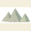
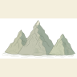
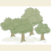
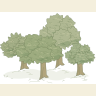
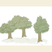

# Third focused island artwork study

**Independent artwork gate: pending on this exact revision. No expansion or runtime promotion.** This responds to Ember?s [second corrections decision](https://github.com/Revty79/serrian-tide-website/pull/4#issuecomment-6207966778) on `e7c68f8`. It is a standalone art-direction study, not application journey/readiness or permanent canon.

## Actual review material

- [Full 2000 ? 1400 PNG](first-island.png), [actual Chrome composition](browser-composition.png), [600px reduction](first-island-600.png), [grayscale](first-island-grayscale.png).
- Native-pixel [mountain detail](details/mountains.png), [woodland and clearings](details/woodland.png), [city/river/label detail](details/city-river-label.png), [unchanged coastline](details/coastline.png).
- [Editable original composition SVG](first-island.svg), [exact retained geographic source](sample-geography.geojson), [original subject revisions, methods and hashes](sample-provenance.json), [actual browser text/artwork bounds](browser-proof.json).
- [Previous study for comparison](../revision-2/first-island.png).

| Exact subject revision | Actual 64px preview | Actual 96px preview |
| --- | --- | --- |
| Rounded mountain, revision 3 |  |  |
| Broadleaf grove, revision 3 |  |  |
| Same broadleaf grove subject, revision 4 |  |  |
| City, revision 2 |  |  |

There are **three subject IDs**, with **two differently drawn footprints for the same grove** (four new original SVG revision files total). These are focused revisions of the reviewed mountain/woodland/city subset. No hills, conifers, new settlement subjects or full starter collection were added. Earlier revisions and the live candidate catalog remain unchanged.

## Visual corrections

| Ember?s blocker | This study?s concrete change |
| --- | --- |
| Dense diagonal of 34 identical grove silhouettes | Seven uneven, separated groupings with broad clearings. Two genuinely different original footprints: a four-tree irregular group and a wider three-tree open edge. Canopy proportions, tree positions/lean and branch windows differ in the source drawing, as well as placement scale/rotation. |
| Nearly circular flat crowns | Smaller unequal lateral boughs, broken lobed contours, translucent shaded leaf masses, varied fine foliage marks, exposed branching/trunks and loose root/grass contact. The alternate footprint is taller on one side and visibly open between trees. |
| Spare triangular mountain faces | A larger irregular stepped ridge with branching creases, interrupted translucent slope washes, fine directional fissures/hatching and loose lower contours. Three unequal profiles read as one range with a softer ground transition. |
| Emblem-like flat city houses | Unequal three-quarter buildings with shaded side walls and roof planes, an interior lane, modest tower, irregular enclosing wall, gate approach, masonry and ground wash. The river remains clear of the town; its headwater was moved just beyond the wider mountain silhouette. This is an illustrated path, with no hydrology simulation. |
| Empty northern land and crowded lower band | The larger range occupies the upper middle; woodland sits in several separated regions and foothills, with visible negative space and no continuous forest strip. The woodland label now occupies a clearing. Coast, river, title hierarchy, compass and restrained palette are retained. |

The sample uses ordinary scale/rotation of exact original revisions. A future approved brush can choose the ordered exact-reference set of grove revisions 3/4 using the already supported v2 `assetRefs`; it need not repeat one footprint or invent thousands of independent rows. **That palette/scatter application behavior still needs implementation and testing.** Fixed sample placements are deterministic study data, not a claim that runtime distribution has been accepted. Using seven instances and real footprint differences addresses the repeat problem before adding new subjects.

## Cody?s review and limits

Cody inspected the full/reduced/grayscale composition, actual thumbnails, native details and Chrome render. **Cody approves this revised direction for Ember?s independent early-art decision:** the open woodland structure, richer contours and architectural depth are a sufficient candidate to proceed if Ember agrees. This is not unilateral permission to expand; expansion remains blocked until Ember explicitly approves this exact pushed revision.

Actual Chrome checks find 11 text boxes and nine artwork instances, with no text/text or text/artwork bounding-box collisions and no external requests. These supplement visual review; they do not establish human usability, physical print quality or full application acceptance. Fontconfig cannot write user caches in the restricted renderer environment; actual text was visually inspected. No physical printing was performed.

The exact same 256-vertex source bytes from revision 2 supply coast and clip. No generator algorithm, scientific source, permanent World or duplicate coastline changed. Artwork is original Codex-assisted SVG code, with no copied/traced/downloaded external illustrations. Distribution/export terms remain the project?s [provenance record](../../../../../public/cartography/serrian-atlas-island/1/PROVENANCE.md). These revisions are unpromoted review candidates.
